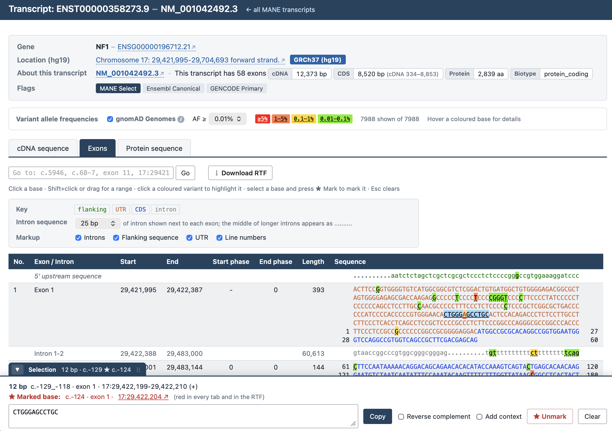
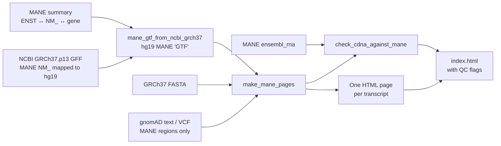

# Ensembl Human Genes

**Ensembl-style MANE transcript pages for hg19 / GRCh37**


This tool generates **one interactive HTML page for each MANE Select and MANE Plus Clinical transcript**. The pages use **hg19 / GRCh37** coordinates and sequence, and they look like Ensembl transcript pages. A searchable index page links them all and flags any page whose sequence does not match MANE.

**NOTE** !!! some MANE transcripts do not have an hg19 equivalent and are therefore not currently generated.

MANE is only defined on GRCh38. Many diagnostic pipelines still run on hg19. This tool takes NCBI's GRCh37 mapping of the MANE RefSeq transcripts, builds each transcript from the GRCh37 genome and labels it with its MANE Ensembl IDs. It then checks every built cDNA against MANE's own sequence, so you know which pages you can trust as they are.

The pages are plain static HTML. You can open them from a shared drive, put them on an intranet share or host them on GitHub Pages.

> **Status:** tested on **hg19 / GRCh37**. **GRCh38 / hg38 support is coming soon.**

---

**[▶ Live demo](https://benstory.github.io/ensembl-human-genes/)** – example pages for NF1 and SRSF2



---

## Contents

- [What you get](#what-you-get)
- [Quick start](#quick-start)
- [Input files: where to download them](#input-files-where-to-download-them)
- [Configuration](#configuration)
- [Output](#output)
- [Understanding the QC flags](#understanding-the-qc-flags)
- [Using the functions directly in R](#using-the-functions-directly-in-r)
- [Requirements](#requirements)
- [How it works](#how-it-works)
- [Roadmap](#roadmap)
- [Caveats](#caveats)
- [License](#license)

---

## What you get

Each transcript page has three views.

| View | What it shows |
|---|---|
| **cDNA sequence** | cDNA, CDS and translation lines. Exons alternate colours, UTRs and alternate codons are highlighted, and lines are numbered. |
| **Exons** | Exon and intron table with coordinates, phases and lengths. It also shows each exon's sequence, plus intron ends and flanks, with a dropdown for 25 to 1,000 bp of intron. |
| **Protein sequence** | Residues coloured by exon. Residues whose codon spans a splice site are shown in red. |

Interactive features:

- **Select sequence**: click a base, Shift+click or drag to select a range, then copy it. You can also take the reverse complement or add a context header line (gene, transcript, HGVS position, genomic coordinates and build).
- **Go to**: jump to `c.5946`, `c.68-7`, `c.-20`, `c.*50`, `exon 11`, `intron 3`, `13:32906729` or `p.100`.
- **Population variants**: gnomAD variants coloured in seven allele-frequency bands (Ensembl's variant colours), with an AF filter. Hover a variant for its details. Each variant links to the gnomAD browser.
- **★ Mark a base**: the marked base shows in red in every view and in the export.
- **RTF export**: download the current view as an RTF file with its colours, for reports or primer design documents.
- **Warnings built into the page**: a banner when the hg19 reference differs from the MANE sequence or the page is not the MANE version, a reverse-strand notice, and alerts for hidden variants inside a selection.
- **Links** to NCBI (RefSeq), Ensembl GRCh37, the UCSC Genome Browser (hg19) and gnomAD.

The **index page** (`index.html`) can be searched by gene, NM_, ENST or chromosome. It has a "flagged only" filter and shows a colour-coded QC flag on each page (see [below](#understanding-the-qc-flags)).

<!-- Tip: add a screenshot here, e.g.  -->

---

## Quick start

```bash
git clone https://github.com/benstory/ensembl-human-genes.git
cd ensembl-human-genes

# 1. Download the input files (see the next section) into this folder
# 2. Edit the paths in the CONFIG block at the top of run_hg19.R
# 3. Run:
Rscript run_hg19.R
```

You can also run it from an R session:

```r
source("run_hg19.R")
```

Then open `mane_pages_hg19/index.html` in a browser.

**Trial run first.** Set `genes = c("BRCA1", "BRCA2")` in the config to build only a few pages. With this setting, only those genes' regions are read from the gnomAD file, so it finishes much faster.

---

## Input files: where to download them

| # | File | Needed? | Source |
|---|---|---|---|
| 1 | `MANE.GRCh38.v1.5.summary.txt.gz` | **Required** | [NCBI MANE FTP](https://ftp.ncbi.nlm.nih.gov/refseq/MANE/MANE_human/current/) |
| 2 | `MANE.GRCh38.v1.5.ensembl_rna.fna.gz` | Recommended (QC) | [NCBI MANE FTP](https://ftp.ncbi.nlm.nih.gov/refseq/MANE/MANE_human/current/) |
| 3 | NCBI GRCh37.p13 annotation, `*_genomic.gff.gz` | **Required** | [NCBI annotation release GCF_000001405.25-RS_2024_09](https://ftp.ncbi.nlm.nih.gov/genomes/refseq/vertebrate_mammalian/Homo_sapiens/annotation_releases/GCF_000001405.25-RS_2024_09/) |
| 4 | GRCh37 genome FASTA | **Required** | [Ensembl GRCh37 FASTA](https://ftp.ensembl.org/pub/grch37/current/fasta/homo_sapiens/dna/) → `Homo_sapiens.GRCh37.dna.primary_assembly.fa.gz` |
| 5 | gnomAD variants (text) | Optional | ANNOVAR `hg19_gnomad_genome` table (see below) |
| 6 | Ensembl GRCh38 GTF | Optional | [Ensembl GTF](https://ftp.ensembl.org/pub/current_gtf/homo_sapiens/), for extra tags (basic, CCDS, APPRIS) |

### Notes on each file

**1–2. MANE files.** The version number in the file names changes with each MANE release. Use the files from `current/` and update the paths in the config to match. For the QC check, use the **full** `ensembl_rna` file and not `select_ensembl_rna`. The Select-only file has no MANE Plus Clinical sequences, so those pages would go unchecked. The script warns you if you use it.

**3. NCBI GRCh37 annotation.** This is NCBI's annotation of GRCh37.p13 with the MANE RefSeq transcripts mapped onto it. In the release folder, download the file whose name ends in `_genomic.gff.gz`. It can stay gzipped.

**4. Genome FASTA.** The FASTA must be **uncompressed or bgzipped**, because a plain `.gz` cannot be indexed:

```bash
gunzip Homo_sapiens.GRCh37.dna.primary_assembly.fa.gz
# or, to keep it compressed:
# gunzip -c Homo_sapiens.GRCh37.dna.primary_assembly.fa.gz | bgzip > GRCh37.fa.gz
```

If [Rsamtools](https://bioconductor.org/packages/Rsamtools/) is installed, the `.fai` index is created automatically on the first run and only the bases each gene needs are read. Without Rsamtools, the whole genome (about 3 GB) is loaded into memory. Chromosome names can be `1` or `chr1`; both work.

**5. gnomAD variants.** The default config expects the ANNOVAR table `hg19_gnomad_genome.txt`, which is **gnomAD v2.0.1 genomes**. ANNOVAR requires (free) registration. With ANNOVAR installed:

```bash
annotate_variation.pl -buildver hg19 -downdb -webfrom annovar gnomad_genome humandb/
# -> humandb/hg19_gnomad_genome.txt
```

Other variant files work too:

- Any tab- or comma-separated text file with chromosome, position, ref, alt and AF columns. Common column names are recognised automatically, including gnomAD browser exports. Otherwise, set `gnomad_cols`.
- A VCF (plain or `.gz`) with `AF=` in INFO.
- A **bgzipped + tabix-indexed** file (`file.vcf.gz` + `file.vcf.gz.tbi`), which is read region by region when Rsamtools is installed. This is the fastest option for genome-wide files.

If you change the variant file, also update `gnomad_label` and `gnomad_cols["af"]`. For example, ANNOVAR's `gnomad211_genome` table is gnomAD v2.1.1.

#### Expected format: ANNOVAR `hg19_gnomad_genome.txt`

A tab-separated text file with one header line. The first lines look like this:

```text
#Chr	Start	End	Ref	Alt	gnomAD_genome_ALL	gnomAD_genome_AFR	gnomAD_genome_AMR	gnomAD_genome_ASJ	gnomAD_genome_EAS	gnomAD_genome_FIN	gnomAD_genome_NFE	gnomAD_genome_OTH
1	10109	10114	AACCCT	-	0.001	0.0035	0	0	0	0.0238	0	0
1	10108	10114	CAACCCT	C	0.001	0.0035	0	0	0	0.0238	0	0
1	10110	10114	ACCCT	-	0.0658	0.0921	0.0833	.	0	0.0882	0.0506	0.0714
1	10109	10114	AACCCT	A	0.0658	0.0921	0.0833	.	0	0.0882	0.0506	0.0714
```

| Column | Used as | Notes |
|---|---|---|
| `#Chr` | chromosome | `1` or `chr1` both work |
| `Start` | position | GRCh37, 1-based |
| `End` | – | not used |
| `Ref` / `Alt` | alleles | ANNOVAR writes indels with `-` (e.g. `AACCCT` → `-`). These are converted to VCF style for labels and gnomAD links. Rows already in VCF style (`CAACCCT` → `C`) work too. |
| `gnomAD_genome_ALL` | allele frequency | overall AF |
| `gnomAD_genome_AFR` … `_OTH` | – | per-population AF, not used by default |

The columns are mapped with `gnomad_cols` in the config in `run_hg19.R`:

```r
gnomad_cols = c(chrom = "#Chr", pos = "Start", ref = "Ref", alt = "Alt", af = "gnomAD_genome_ALL")
```

- **The `af` entry is needed.** The chromosome, position, ref and alt columns are recognised automatically, but `gnomAD_genome_ALL` is not a standard AF column name.
- **To colour by one population instead,** point `af` at its column, e.g. `af = "gnomAD_genome_NFE"` for non-Finnish Europeans. Then update `gnomad_label` so the pages say which AF is shown.
- **Other files:** if your file uses different headers, e.g. `CHR BP REF ALT AF`, set them here: `c(chrom = "CHR", pos = "BP", ref = "REF", alt = "ALT", af = "AF")`.
- **Missing values:** rows whose AF column is `.` are skipped.


---

## Configuration

All settings are in the `cfg` list at the top of **`run_hg19.R`**:

| Setting | Default | Meaning |
|---|---|---|
| `mane_summary` | `MANE.GRCh38.v1.5.summary.txt` | MANE summary file (ENST ↔ NM_ ↔ gene) |
| `mane_rna` | `MANE.GRCh38.v1.5.ensembl_rna.fna` | MANE sequences for the QC check; `NULL` to skip |
| `ncbi_gff37` | `GCF_000001405.25_GRCh37.p13_genomic.gff` | NCBI GRCh37 annotation |
| `fasta` | `GRCh37.primary_assembly.genome.fa` | GRCh37 genome (uncompressed or bgzipped) |
| `gnomad` | `~/Downloads/hg19_gnomad_genome.txt` | Variant file; `NULL` for none |
| `gnomad_cols` | ANNOVAR column names | Column mapping, used only if columns aren't recognised |
| `gnomad_label` | `gnomAD v2.0.1 genomes (GRCh37, via ANNOVAR)` | Data source shown on pages and in the footer |
| `genes` | `NULL` (all) | e.g. `c("BRCA1", "BRCA2")` for a trial run |
| `out_dir` | `mane_pages_hg19` | Output folder |
| `intron_max` | `1000` | bp of each intron end embedded in the pages (larger values make larger files) |
| `variant_label` | `gnomAD Genomes` | Label on the variant checkbox |
| `min_af` | `1e-4` | Variants below 0.01% are left out |
| `af_default` | `0.001` | AF filter the pages open with (0.1%) |
| `include_plus_clinical` | `TRUE` | Also build MANE Plus Clinical pages |
| `flags_gtf` | `NULL` | Optional Ensembl GRCh38 GTF for extra transcript tags |


---

## Output

```
mane_pages_hg19/
├── index.html                    # searchable index with QC flags (open this)
├── BRCA2_NM_000059.html          # one page per transcript: GENE_NM_xxxxxx.html
├── ...
├── pages.csv                     # page list: gene, IDs, location, exons, cDNA/protein length, file
├── qc_cdna_vs_mane.csv           # hg19-built cDNA vs MANE sequence (length, mismatches)
├── mane_version_fallback.csv     # pages built from another RefSeq version (not MANE)
└── mane_not_on_grch37.csv        # MANE transcripts NCBI did not place on GRCh37 (no page)
```

Each page is self-contained, so you can copy or share single files. Every page carries a footer with its data sources: the date, MANE version, NCBI annotation release, genome file, variant source with its AF cut-off, and the build.

To rebuild only the index (for example, after editing the CSVs):

```bash
Rscript make_index.R mane_pages_hg19
```

---

## Understanding the QC flags

hg19 is not the genome MANE was defined on, so a transcript built from hg19 does not always match MANE exactly. Every page is compared with MANE's own transcript sequence, and the index flags the differences:

| Flag | Meaning | What to do |
|---|---|---|
| 🟥 **length differs** | The hg19 exons do not add up to the MANE transcript length. | The **c. numbers on the page may not match official NM numbering.** Find variants by **genomic position**. |
| 🟨 **N bases differ** | Same length, but some hg19 reference bases differ from MANE (listed on the page). | c. numbering is correct. Primers over those bases may not match. |
| 🟨 **NOT MANE** | The exact MANE version (e.g. `NM_000267.4`) is not placed on GRCh37, so the page shows the version that is placed (e.g. `NM_000267.3`). | It is a real RefSeq transcript with its own structure and numbering. Check nomenclature against the MANE accession before reporting. |
| ⬜ **not checked** | No QC comparison for this page. | Usually means `mane_rna` was not set or was the Select-only file. |

MANE transcripts that NCBI did not place on GRCh37 at all have no page. They are listed at the bottom of the index and in `mane_not_on_grch37.csv`.

---

## Using the functions directly in R

`run_hg19.R` is a thin wrapper. The building blocks are reusable:

```r
source("mane_pages.R")   # page builder: works with any GTF that carries MANE tags
source("mane_hg19.R")    # hg19-specific: NCBI GRCh37 mapping + QC

summary <- read_mane_summary("MANE.GRCh38.v1.5.summary.txt.gz")
gtf37   <- mane_gtf_from_ncbi_grch37("GCF_000001405.25_GRCh37.p13_genomic.gff.gz", summary)

fasta <- Rsamtools::FaFile("GRCh37.fa")            # or read_fasta_simple("small.fa")
vars  <- read_variants_text("hg19_gnomad_genome.txt",
                            regions = mane_regions(gtf37, pad = 1100))

pages <- make_mane_pages(gtf37, fasta, variants = vars, out_dir = "out",
                         genes = c("BRCA1", "BRCA2"),
                         genome_build = "GRCh37 (hg19)",
                         reference_cdna = "MANE.GRCh38.v1.5.ensembl_rna.fna.gz")

qc <- check_cdna_against_mane(pages, "MANE.GRCh38.v1.5.ensembl_rna.fna.gz")

source("make_index.R"); make_simple_index("out")
```

`make_mane_pages()` accepts the GTF as an `rtracklayer` import, a `GRanges`, a raw 9-column data frame or `read_gtf_simple()` output. The FASTA can be a `DNAStringSet`, an `FaFile` or a named character vector. Variants can be a data frame, a `VariantAnnotation` VCF or a `vcfR` object.

---

## Requirements

- **R ≥ 4.0** (the scripts use raw strings `r"(...)"`)
- **Base R only.** No packages are required.
- **Recommended:** [Rsamtools](https://bioconductor.org/packages/Rsamtools/) (Bioconductor) for indexed FASTA access and tabix-indexed variant files:

  ```r
  install.packages("BiocManager"); BiocManager::install("Rsamtools")
  ```

- Without Rsamtools, allow about 3–4 GB of RAM to hold the genome in memory.
- **Browser:** any modern browser. The variant and selection colouring uses the CSS Custom Highlight API (current Chrome, Edge, Safari and Firefox).

---

## How it works



1. **Annotation.** Each MANE RefSeq transcript (NM_/NR_) and its paired ENST are identical in exons, UTRs and CDS. So NCBI's GRCh37 placement of the NM_ gives the MANE transcript's structure on hg19. Rows are relabelled with the ENST/ENSG from the MANE summary. Only primary chromosomes are used, with one alignment per transcript (the chrY PAR copy is avoided). Selenocysteine codons are carried over so they translate to `U`.
2. **Version fallback.** If the exact MANE version isn't placed on GRCh37, the highest placed version is used. That page is clearly labelled **NOT MANE**.
3. **Sequence.** The cDNA, CDS, protein, introns and flanks are cut from the GRCh37 genome.
4. **Variants.** Only rows inside the page regions (each transcript ± `intron_max` + 100 bp) are read, so a genome-wide gnomAD file never has to fit in memory. ANNOVAR-style indels are converted to VCF-style labels for the gnomAD links.
5. **QC.** Each built cDNA is compared base by base with the MANE `ensembl_rna` sequence. Differences appear on the page and as flags in the index.

---

## Roadmap

- [x] hg19 / GRCh37: tested
- [ ] **GRCh38 / hg38: coming soon.** MANE is native to GRCh38, so this will read the MANE GTF directly and needs no remapping.
- [ ] gnomAD v4 support for hg38 pages

---

## Repository layout

| File | Role |
|---|---|
| `run_hg19.R` | **Main script.** Config block plus the 5-step pipeline. |
| `mane_hg19.R` | Builds the hg19 MANE annotation from NCBI's GRCh37 GFF, adds optional tags and runs the cDNA QC. |
| `mane_pages.R` | Page builder: transcript models, HTML/CSS/JS, variant reading and the original table index. |
| `make_index.R` | Fast searchable `index.html` with QC flags. Can also be run on its own. |

---

## Caveats

- MANE is defined on **GRCh38**. On hg19, a transcript can differ from MANE because of reference differences between the builds. Always check the QC flags and on-page warnings, especially **length differs** and **NOT MANE**, before using c. numbering.
- gnomAD v2 has **no chrY variants**. Pages on chromosomes the variant file doesn't cover say so, so missing colours there do not mean missing variants.
- The gnomAD links on hg19 pages open **gnomAD v2.1.1 (GRCh37)**. The default variant file is v2.0.1, so the frequencies may differ slightly.
- This is a tool for viewing and preparing sequences. It is **not a validated clinical reporting system**. Check variant nomenclature against the official RefSeq/Ensembl records.

---

## License

Released under the [Zero-Clause BSD license (0BSD)](LICENSE), © 2026 Benjamin Story. You can use, copy, modify and distribute this code for any purpose, with or without attribution.

The input data (MANE, RefSeq, Ensembl, gnomAD, ANNOVAR) are not part of this repository and have their own terms of use.

---

## Acknowledgements

This project is independent and is not affiliated with or endorsed by Ensembl, EMBL-EBI or NCBI. The name refers to the Ensembl-style page layout.

- [MANE](https://www.ncbi.nlm.nih.gov/refseq/MANE/): NCBI and EMBL-EBI
- [NCBI RefSeq](https://www.ncbi.nlm.nih.gov/refseq/) GRCh37.p13 annotation
- [Ensembl](https://grch37.ensembl.org/): genome sequence; page layout modelled on Ensembl transcript pages; variant colour scheme
- [gnomAD](https://gnomad.broadinstitute.org/) and [ANNOVAR](https://annovar.openbioinformatics.org/)
